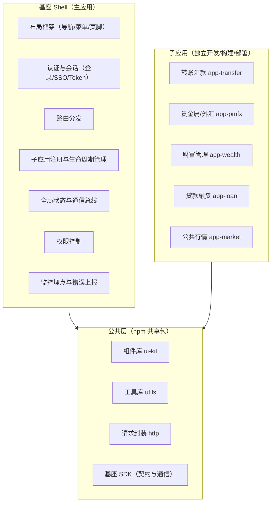

# OneBank 银行基座平台 · 规划文档（基线）

| 项目名称 | OneBank 银行基座平台（one-bank） |
| --- | --- |
| 文档版本 | v0.3（新增阶段范围、非功能基线两节） |
| 创建日期 | 2026-11-17 |
| 文档状态 | 架构与模块范围基准 · 变更须先在 doc/feat/ 立记录 |
| 维护人 | 待填写 |

> 构建一个银行前端基座平台（Main App / Shell），采用微前端架构，支持多个业务子应用的独立开发、独立构建、独立部署与运行时动态接入。基座负责：整体布局与导航、登录认证与会话、路由分发、子应用注册与生命周期管理、全局状态与跨应用通信、权限控制、监控埋点。
>
> 业务上划分为五个子应用：转账汇款（app-transfer）、贵金属/外汇交易（app-pmfx）、财富管理（app-wealth）、贷款融资（app-loan）、公共行情服务（app-market，向其他子应用提供行情数据）。
>
> 当前阶段目标：**先完成基座搭建**，并以"基座 + 一个最小子应用"作为第一个原子交付单元，跑通接入协议后再逐个接入其余模块。

---

## 1. 总体架构

基座七项职责：布局框架、认证与会话、路由分发、子应用注册与生命周期管理、全局状态与通信总线、权限控制、监控埋点。

子应用边界：只关心自身业务，跨应用协作一律经基座 SDK 或公共行情服务，禁止直接引用彼此内部代码。

---

## 2. 业务模块划分

| 业务模块 | 子应用名 | 路由前缀 | 本期最小职责集 | 优先级 | 备注 |
| --- | --- | --- | --- | --- | --- |
| 转账汇款 | `app-transfer` | `/transfer` | 行内/跨行转账、收款人管理、转账记录 | P1 | 表单流程类，作为复杂交互验证样板 |
| 贵金属/外汇交易 | `app-pmfx` | `/pmfx` | 贵金属买卖、购汇/结汇、委托记录 | P2 | 强依赖公共行情 |
| 财富管理 | `app-wealth` | `/wealth` | 产品列表、产品详情、持仓查询 | P2 | 依赖行情（净值） |
| 贷款融资 | `app-loan` | `/loan` | 产品展示、申请进件、还款计划查询 | P3 | 流程审批类 |
| 公共行情服务 | `app-market` | `/market` | 汇率/金价/净值行情拉取、订阅与展示；经基座总线向其他子应用提供行情数据 | P1 | 被多个模块依赖，需首批接入 |

> 优先级为建议值，最终以业务排期为准。

---

## 3. 阶段范围（In / Out of Scope）

**In scope（本期做）**

- 基座骨架：布局、路由分发、子应用注册与生命周期调度、登录（mock）、全局错误兜底；
- 首个原子单元：**基座 + 公共行情最小版（app-market）**，验证完整接入协议（注册 / 生命周期 / 路由 / 通信 / 鉴权链路）；
- 接入规范与验收清单（doc/test/）文档化。

**Out of scope（本期不做）**

- 五个业务模块的完整业务功能；
- 生产级 SSO / 网关对接（先 mock，接口预留，对接结论记入 doc/arch/）；
- 配置中心动态注册、灰度发布等高级能力（列入后续迭代）。

> 原子单元拆解与推进顺序见 doc/feat/ 各迭代文件；范围调整须先立 feat 记录，再同步更新本节。

---

## 4. 非功能基线

| 维度 | 基线要求 |
| --- | --- |
| 安全 | Token/会话不得明文落盘；401 统一由基座处理并回到登录；金额展示统一走公共工具格式化；前端校验不作为业务合规的唯一防线 |
| 性能 | 基座首屏 ≤ 2s（测试环境基线）；子应用按需加载；行情推送须节流，避免高频渲染 |
| 稳定性 | 任一子应用加载失败或崩溃不得白屏、不得影响基座与其他子应用（错误边界 + 兜底 UI） |
| 兼容性 | 目标浏览器范围以行内渠道标准为准（待确认后在 doc/adr/ 记录） |
| 可维护性 | 接入契约以 TypeScript 类型为准；破坏性契约变更须升主版本并做兼容层 |
